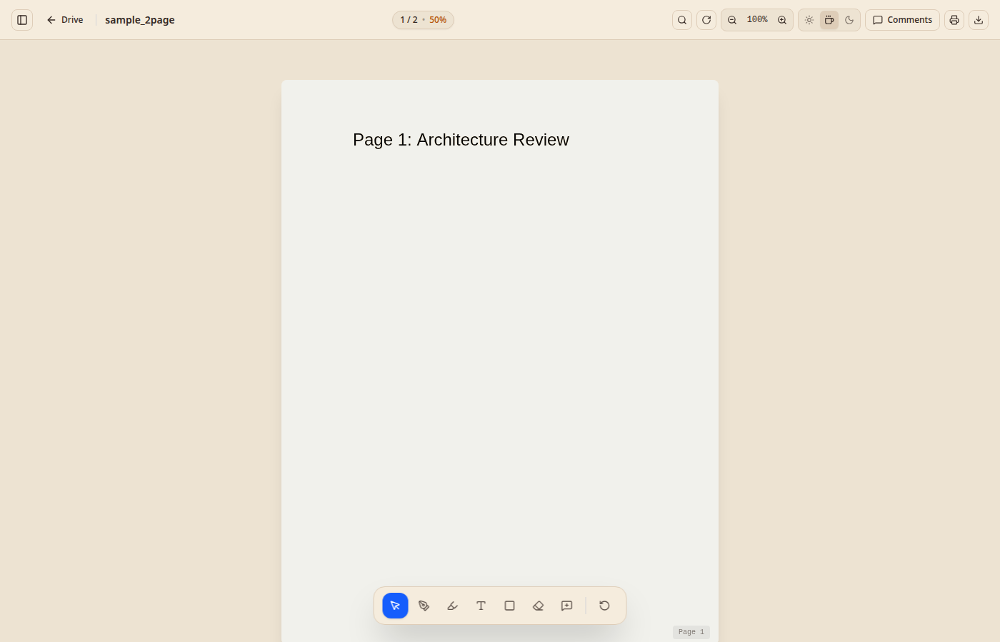
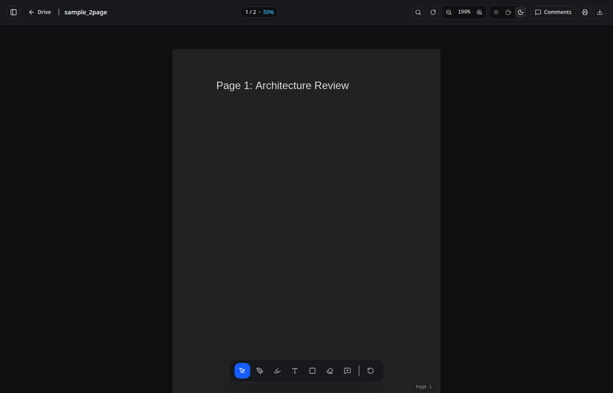
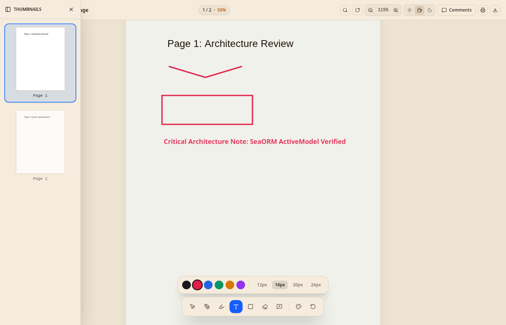
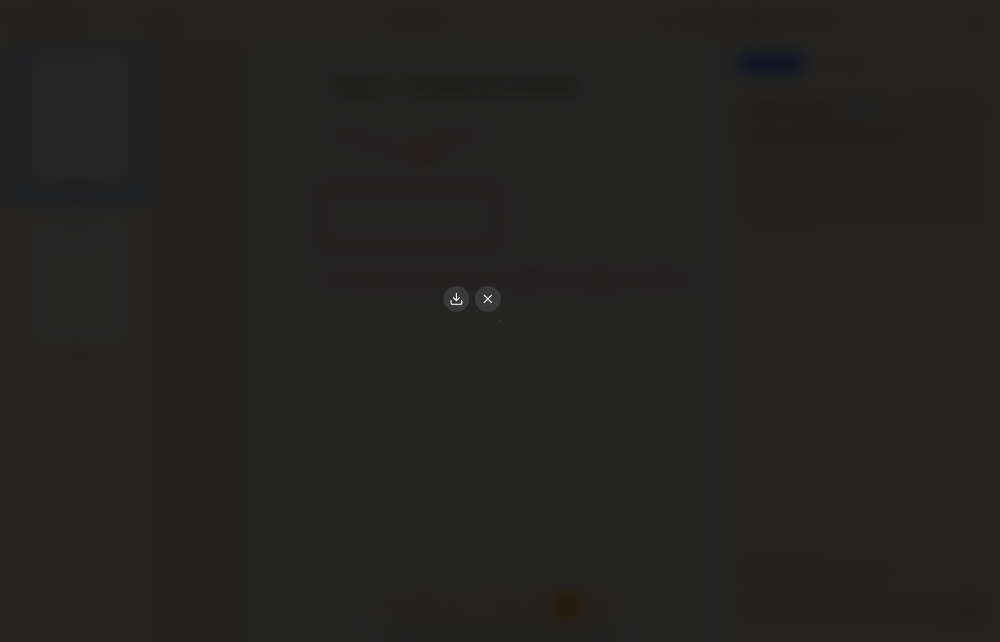
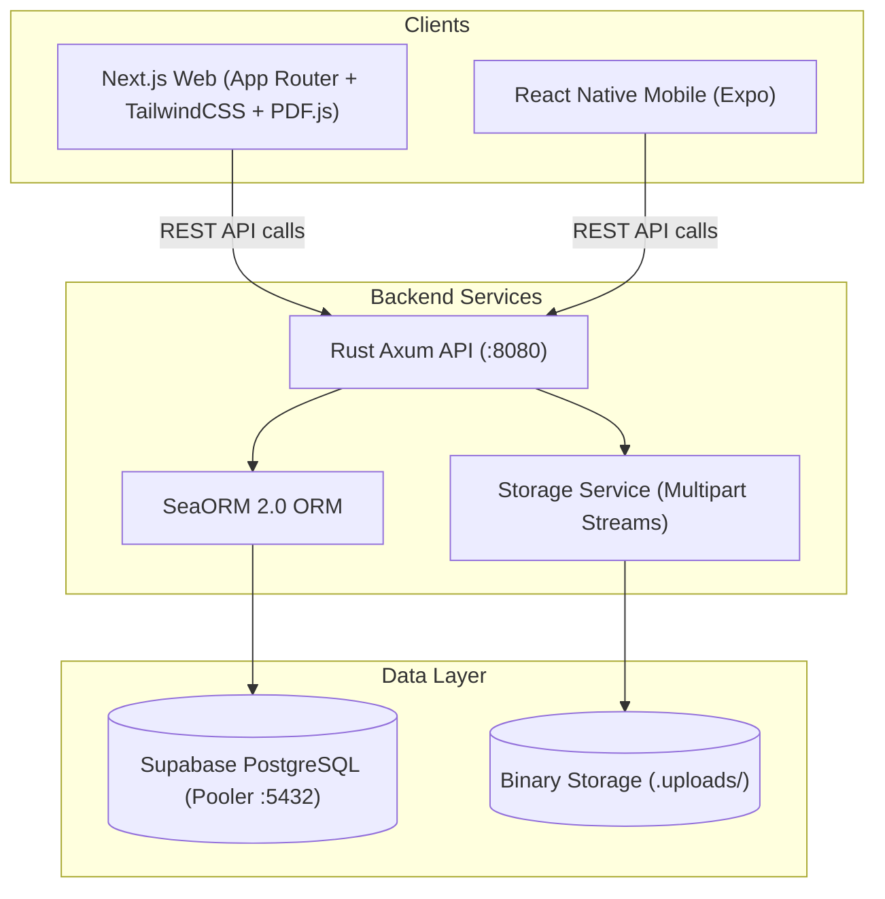

# Aura: Eye-Friendly PDF Drive & Annotation Reader

[](backend)
[](web)
[](mobile)
[](docs/DATABASE_SCHEMA.sql)
[](LICENSE)

A high-performance, eye-friendly PDF viewer and cloud drive system with multi-page continuous reading, full vector markup (pen scribbles, highlights, text notes, callout boxes), reading progress auto-synchronization, and threaded comments with image attachments.

---

## Visual Showcase

| Warm Sepia Paper Mode | OLED Night Reading Mode |
|---|---|
|  |  |

| Vector Annotations & Shapes | Threaded Comments & Image Lightbox |
|---|---|
|  |  |

---

## Key Features

1. **Eye-Comfort Ergonomics**:
   - **Warm Linen Sepia Paper** (`#F6F0E6` linen, `#2C2523` charcoal ink): Eliminates harsh glare.
   - **OLED Charcoal Night** (`#131416` background, `#DDE1E5` soft text): Comfortable in dark environments.
   - **Natural Daylight** (`#FAFAF8` background, `#18181B` text): High-fidelity document rendering.
2. **Reading & Document Navigation**:
   - Multi-page vertical continuous scroll.
   - Live page thumbnails rail ([`ThumbnailsSidebar`](web/src/components/viewer/ThumbnailsSidebar.tsx)).
   - In-document text search with match counts, snippet preview, and jumping ([`SearchBar`](web/src/components/viewer/SearchBar.tsx)).
   - 90° clockwise document rotation per click.
   - Smooth zoom in/out with fit-width scaling.
3. **Annotation & Vector Markup**:
   - **Freehand Pen**: Smooth bezier paths with color palette and stroke width adjustment.
   - **Highlighter**: Semi-transparent square-cap ink overlay.
   - **Rectangle / Callout Box**: Resizable framing shapes.
   - **Text Notes**: Click-to-place typographic notes directly on the page overlay.
   - **Targeted Eraser**: Hit-testing engine to erase individual vector strokes, shapes, or notes.
4. **Threaded Comments with Image Attachments**:
   - Drop pinpoint markers at exact percentages `(x, y)` on any page.
   - Sidebar discussion drawer grouped by page or document-wide.
   - Full-resolution image lightbox preview with download options.
5. **Reading Progress Auto-Sync**:
   - Debounced automatic tracking of current page, zoom level, and scroll position saved to Supabase Postgres via the Rust Axum backend.
   - Resumes exact reading position upon reload.
6. **Storage Quota Enforcement**:
   - Strictly enforces a **≤10MB file limit** on uploads, protecting database and storage quotas.

---

## Architecture & Tech Stack



### Architectural Invariants
- **Zero Direct Database Calls from Frontend/Mobile**: Neither web nor mobile query Supabase directly via SQL or JS client; all traffic routes through the Rust Axum API.
- **SeaORM Typed Entities**: All database operations use SeaORM `ActiveModel`, `Entity`, and `RelationDef` without raw SQL strings.

---

## Directory Structure

```
pdf-viewer/
├── backend/                   # Rust Axum Backend
│   ├── Cargo.toml
│   ├── src/
│   │   ├── main.rs            # Axum server & routes
│   │   ├── config.rs          # Environment loader
│   │   ├── db.rs              # SeaORM pool connection
│   │   ├── entities/          # SeaORM active models & entities
│   │   ├── handlers/          # API request handlers
│   │   └── services/          # File storage & PDF parser
│   └── tests/                 # Integration tests
├── web/                       # Next.js 16 Web Application
│   ├── src/app/               # App Router pages (/ and /viewer/[id])
│   ├── src/components/        # Drive, Viewer, Annotations, Comments
│   └── src/services/api.ts    # REST Client connecting to Rust
├── mobile/                    # React Native Expo Mobile App
│   ├── App.tsx
│   ├── src/components/        # Touch-friendly reader & annotation components
│   └── src/services/api.ts    # API client connecting to Rust
└── docs/                      # Architectural specs & database DDL
    ├── ARCHITECTURE.md
    └── DATABASE_SCHEMA.sql
```

---

## Getting Started

### 1. Database Setup
Create the required tables in Supabase Postgres using [docs/DATABASE_SCHEMA.sql](docs/DATABASE_SCHEMA.sql).

### 2. Backend (Rust)
```bash
cd backend
cp .env.example .env
# Fill in your DATABASE_URL in .env
cargo run
```
The server will start on `http://0.0.0.0:8080`.

### 3. Web Frontend (Next.js)
```bash
cd web
cp .env.example .env.local
pnpm install
pnpm dev
```
Open `http://localhost:3000` in your browser.

### 4. Mobile App (Expo)
```bash
cd mobile
cp .env.example .env
pnpm install
pnpm start
```

---

## License
MIT
