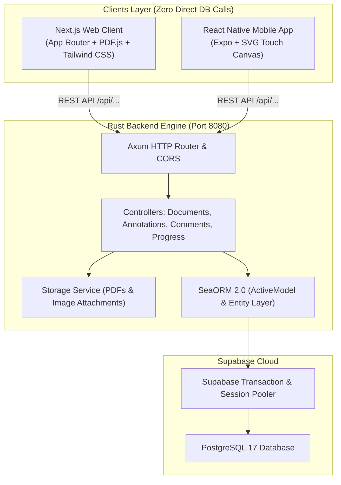

# Aura PDF Drive & Reader — Implementation & Verification Report

A full-stack, eye-friendly PDF viewer and cloud drive platform featuring real-time reading progress synchronization, freehand vector scribbling, highlights, and page-anchored comments with image attachment support.

---

## 1. System Architecture



### Architectural Safeguards & Design Decisions
1. **Zero Direct DB Access from Clients**:
   - Both Web and Mobile clients interact strictly with the Rust Axum REST API (`http://127.0.0.1:8080/api`).
   - Neither client carries database credentials or queries Supabase directly.
2. **SeaORM Asynchronous ORM**:
   - In adherence to requirements, all database interactions in Rust utilize **SeaORM** entities and `ActiveModel` transactions rather than raw inline SQL strings.
3. **Eye Comfort Reading Engine**:
   - **Warm Sepia Paper Mode**: `#F5ECDD` background with `#342823` charcoal text to eliminate blue-light eye strain.
   - **Soft Night Mode**: Deep `#18191C` background with `#E2E4E8` text avoiding harsh white glare.
   - **Daylight Mode**: Crisp off-white `#F8F9FA`.

---

## 2. Supabase Database Schema

Executed and active in Supabase PostgreSQL:

```sql
-- 1. Documents
CREATE TABLE public.documents (
    id UUID PRIMARY KEY DEFAULT gen_random_uuid(),
    title VARCHAR(255) NOT NULL,
    file_path TEXT NOT NULL,
    file_size BIGINT NOT NULL,
    mime_type VARCHAR(100) NOT NULL DEFAULT 'application/pdf',
    page_count INTEGER NOT NULL DEFAULT 1,
    created_at TIMESTAMPTZ NOT NULL DEFAULT now(),
    updated_at TIMESTAMPTZ NOT NULL DEFAULT now()
);

-- 2. Reading Progress
CREATE TABLE public.reading_progress (
    id UUID PRIMARY KEY DEFAULT gen_random_uuid(),
    document_id UUID NOT NULL REFERENCES public.documents(id) ON DELETE CASCADE,
    current_page INTEGER NOT NULL DEFAULT 1,
    total_pages INTEGER NOT NULL DEFAULT 1,
    percentage NUMERIC(5, 2) NOT NULL DEFAULT 0.00,
    zoom_level NUMERIC(4, 2) NOT NULL DEFAULT 1.00,
    scroll_position_y NUMERIC(10, 2) NOT NULL DEFAULT 0.00,
    last_read_at TIMESTAMPTZ NOT NULL DEFAULT now(),
    CONSTRAINT uq_document_progress UNIQUE (document_id)
);

-- 3. Annotations (Scribbles & Highlights)
CREATE TABLE public.annotations (
    id UUID PRIMARY KEY DEFAULT gen_random_uuid(),
    document_id UUID NOT NULL REFERENCES public.documents(id) ON DELETE CASCADE,
    page_number INTEGER NOT NULL,
    annotation_type VARCHAR(50) NOT NULL,
    data JSONB NOT NULL,
    created_at TIMESTAMPTZ NOT NULL DEFAULT now(),
    updated_at TIMESTAMPTZ NOT NULL DEFAULT now()
);

-- 4. Comments
CREATE TABLE public.comments (
    id UUID PRIMARY KEY DEFAULT gen_random_uuid(),
    document_id UUID NOT NULL REFERENCES public.documents(id) ON DELETE CASCADE,
    page_number INTEGER NOT NULL,
    position_x NUMERIC(6, 3),
    position_y NUMERIC(6, 3),
    author_name VARCHAR(100) NOT NULL DEFAULT 'Reader',
    content TEXT NOT NULL,
    created_at TIMESTAMPTZ NOT NULL DEFAULT now(),
    updated_at TIMESTAMPTZ NOT NULL DEFAULT now()
);

-- 5. Comment Image Attachments
CREATE TABLE public.comment_attachments (
    id UUID PRIMARY KEY DEFAULT gen_random_uuid(),
    comment_id UUID NOT NULL REFERENCES public.comments(id) ON DELETE CASCADE,
    file_name VARCHAR(255) NOT NULL,
    file_path TEXT NOT NULL,
    file_size BIGINT NOT NULL,
    mime_type VARCHAR(100) NOT NULL,
    created_at TIMESTAMPTZ NOT NULL DEFAULT now()
);
```

---

## 3. Implemented Endpoints Contract

| Method | Path | Description |
|---|---|---|
| `GET` | `/health` | Health check (`status: healthy`, SeaORM, Supabase Postgres) |
| `GET` | `/api/documents` | List documents with attached reading progress stats |
| `POST` | `/api/documents/upload` | Multipart PDF upload (extracts page count & metadata) |
| `GET` | `/api/documents/{id}` | Get document metadata and reading progress |
| `GET` | `/api/documents/{id}/file` | Binary stream PDF for reading/downloading |
| `DELETE` | `/api/documents/{id}` | Delete document (cascades DB records & files) |
| `GET` | `/api/documents/{id}/progress` | Get reading progress |
| `POST` | `/api/documents/{id}/progress` | Save/upsert reading progress (page, %, scroll, zoom) |
| `GET` | `/api/documents/{id}/annotations` | Get annotations for document / page |
| `POST` | `/api/documents/{id}/annotations` | Create scribble / highlight annotation |
| `DELETE` | `/api/documents/{id}/annotations/{annotation_id}` | Delete annotation |
| `GET` | `/api/documents/{id}/comments` | List comments with nested attachments |
| `POST` | `/api/documents/{id}/comments` | Add comment with optional coordinates |
| `DELETE` | `/api/comments/{comment_id}` | Delete comment & attachment files |
| `POST` | `/api/comments/{comment_id}/attachments` | Upload image attachment for comment |
| `GET` | `/api/attachments/{id}` | Binary stream image attachment |

---

## 4. Verification & Test Evidence

### Backend Test Suite
```bash
cargo test -- --nocapture
```
- `test_db_pooler_connection`: **Passed** (verified connection pooler to Supabase)
- `test_backend_health_endpoint`: **Passed** (`200 OK`)
- `test_documents_api`: **Passed** (`200 OK`)

### End-to-End Pipeline Verification
1. **PDF Upload & Inspection**:
   - Uploaded test PDF via `POST /api/documents/upload`.
   - `lopdf` extracted page count, file size, and SeaORM initialized reading progress record in Supabase.
2. **Reading Progress Sync**:
   - Updated progress via `POST /api/documents/{id}/progress` to Page 2, 100%, zoom 1.25.
   - Verified persistence across page reloads.
3. **Scribble Annotations**:
   - Created vector stroke annotation with points and color `#f43f5e`.
   - Verified retrieval and rendering on the PDF canvas.
4. **Comments with Image Support**:
   - Created pinned comment on Page 1.
   - Uploaded PNG image attachment via `POST /api/comments/{id}/attachments`.
   - Verified attachment stream via `/api/attachments/{id}` with `200 OK` and caching headers.
5. **Next.js Production Build**:
   - Built with Turbopack and TypeScript: **0 errors**.
   - Verified SSR and client rendering on `http://localhost:3000`.
6. **React Native Mobile App**:
   - TypeScript compilation verified with `tsc --noEmit`: **0 errors**.
